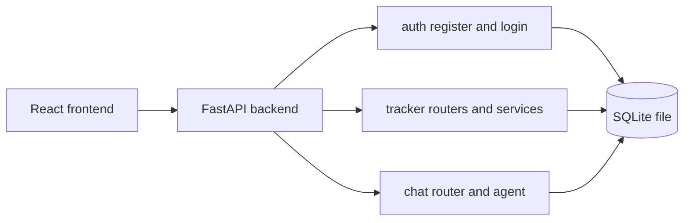

## Architecture Overview

Parsel uses a clear split:

- `backend/` for FastAPI APIs, domain logic, and database access.
- `frontend/` for the React UI.

The API is stateless and directly calls feature services.

Scripts for non-developers live in `run-parsel/<os>/` (`windows`, `macos`, `linux`; see the README's Quick setup):

- `setup`: install and update in one. Pulls the `release` branch (`git pull --ff-only`, then restarts itself so the shell never runs a half-replaced file), installs missing Python 3.11+ and Node.js 18+ (winget / Homebrew / apt), installs packages, then runs `run-parsel/configure.py`: writes `backend/.env` only if missing, and calls `init_database()`.
- `start`: backend (uvicorn, port 8000) in the background, frontend (Vite, port 5173, `--strictPort`) in the foreground, and `run-parsel/open_browser.py` opens the browser once port 5173 answers. Closing the window stops both.

## Backend structure

- `backend/main.py`: FastAPI app setup, CORS, router registration, JWT auth wiring.
- `backend/common/`: shared database, declarative base, and logging utilities.
- `backend/auth/`: user model, register/login, JWT helpers, `get_current_user` dependency.
- `backend/tracker/`: transactions, dashboard services, constants, schemas, routers (scoped by `user_id`).
- `backend/tracker/bank_import/`: bank statement parsers (SBI Excel/PDF, Kotak PDF, Slice PDF) used by transaction import preview.
- `backend/tracker/category_service.py`: also owns statement category suggestions (`suggest_categories`): exact merchant-key match against the user's own ledger; no match or a failed lookup leaves the category blank.
- `backend/chat/`: chat agent graph and chat API routes (thread + SQL scoped to user); schema/prompt include `bank`.
- `backend/tests/`: backend tests.

## Database access

Data lives in one SQLite file: `DATABASE_PATH`, default `<repo>/data/parsel.db` (WAL mode, `foreign_keys=ON`, 5s `busy_timeout`). `backend/common/database.py` exposes:

- `get_connection()` — read/write (transactional commit). Transactions start with `BEGIN IMMEDIATE`, which serializes writers; SQLite has no row locks, so the `with_for_update()` calls in services are no-ops kept for readability.
- `get_readonly_connection()` — `AUTOCOMMIT` for pure SELECTs. Prefer it for auth lookups and other hot read paths.
- `init_database()` — runs at API startup (FastAPI lifespan) and from setup. Applies each pending `migrations/NNN_*.sql` in its own transaction, tracking progress in `PRAGMA user_version`, and backs up the file to `parsel.db.bak-v<old>` first (newest 3 kept). Refuses to start if `.env` still has a PostgreSQL `DATABASE_URL`.
- `run_agent_query(sql, user_id=...)` — the chat agent's only DB access: a separate read-only (`mode=ro`) connection, one statement, 10s limit, at most `AGENT_MAX_ROWS` (200) rows with a `truncated` flag. Temp views make `transactions` mean only that user's rows: a randomly named view filters on `user_id`, and `transactions` aliases it. An authorizer allows `SELECT` and lets reads of `main.transactions` through only via that view, so `users`, `PRAGMA`, `ATTACH`, writes, `main.transactions` and look-alike CTEs are refused. `agent_node` sets the user id in the `AGENT_USER_ID` context variable (never a tool argument, so the model can't pick it); `execute_query` refuses without it and passes SQLite's error text back so the model can fix its query.

Engines use `NullPool` (opening a SQLite connection is cheap). Column types in `backend/common/base.py`: `UUIDText` stores UUIDs as dashed text; `UTCDateTime` stores naive UTC and returns tz-aware UTC. Money is `REAL`, read back as a 2-dp `Decimal`.

## Frontend structure

- `frontend/src/App.tsx`: auth routes, protected shell, and navigation.
- `frontend/src/lib/auth.tsx`: AuthProvider and token session helpers.
- `frontend/src/pages/AuthPage.tsx`: login and register.
- `frontend/src/pages/OverviewPage.tsx`: dashboard view with month and multi-bank filters.
- `frontend/src/pages/SearchPage.tsx`: searchable transaction ledger with bank column/filter, edit/delete/export.
- `frontend/src/components/data-table/`: reusable TanStack Table pieces (shell, sortable header, pagination, column visibility, filter select) driven in manual mode against server-side paging.
- `frontend/src/pages/AddPage.tsx`: transaction create/import (CSV or bank statement) with review table; banks come from `/config/tracker`.
- `frontend/src/pages/ChatPage.tsx`: chat UI with invoke/resume/exit flow.
- `frontend/src/api/`: fetch wrappers for API calls (Bearer token attached in `client.ts`).

## Runtime flow

## API boundaries

- Auth (public)
  - `/auth/register`
  - `/auth/login`
- Tracker (Bearer JWT required; data scoped to current user)
  - `/config/tracker` — categories, payment methods, banks allowlist
  - `/transactions/*` — CRUD, search, CSV export, import preview/commit (CSV + statements)
  - `/dashboard/overview` — optional `banks=` filter; returns `active_banks`, per-category `prev_spend`/`txn_count` and per-bank `freshness`
  - `/dashboard/insight?month=YYYY-MM` — insight of the month. Facts come from SQL, the LLM (same model as Chat) only phrases them, and numbers it invents are rejected in favour of a template sentence. Cached per user and month in `monthly_insights`; the cache is reused until the month's transactions change. Separate from the overview so the LLM never slows the dashboard
  - `PUT /categories/{name}/limit` — monthly category limit, stored in `users.preferences.category_limits` (no table)
- Chat (Bearer JWT required; threads and SQL scoped to current user)
  - `/chat/invoke`
  - `/chat/resume`
  - `/chat/exit`
  - If the LLM or a tool fails partway through a turn (e.g. a Groq 429), the call returns 200 with a technical-error reply as the assistant message, and the thread can still be resumed

## Stitch integration notes

- MCP config is stored in `.cursor/mcp.json`.
- Design payload files are expected in `docs/design/`.
- Frontend uses fallback route mapping in `docs/design/stitch-route-map.md` until full Stitch payloads are retrieved.
